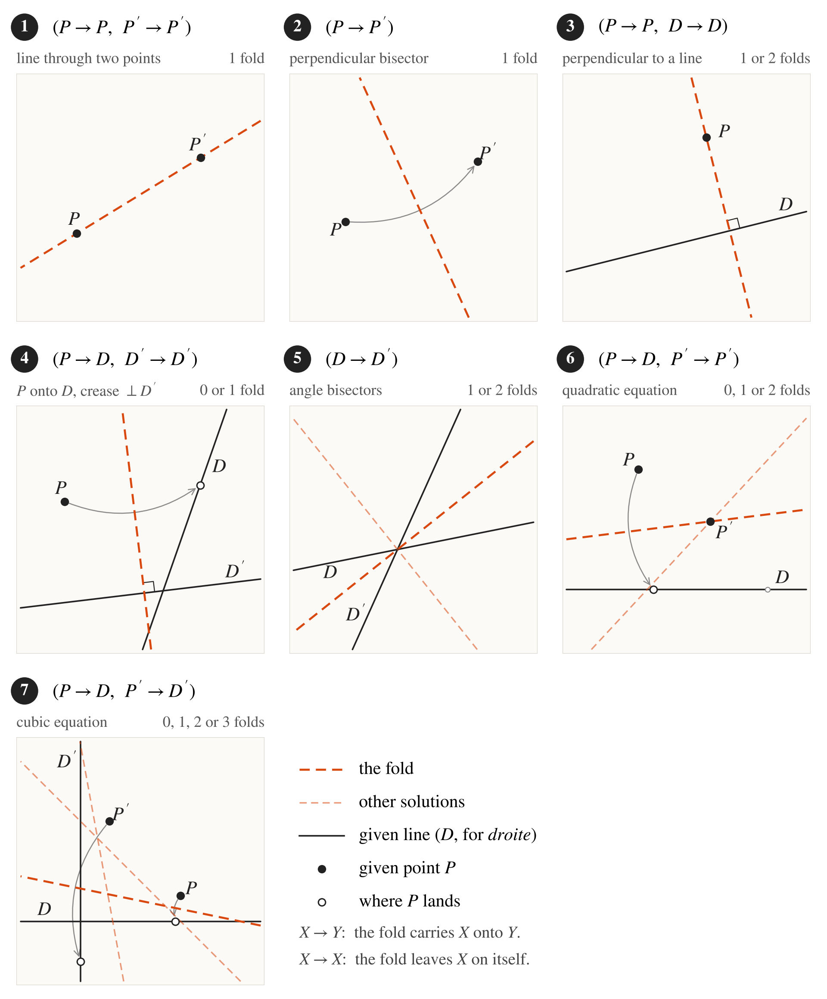

## The question

Open almost any paper on origami constructions and the first sentence tells you that in 1989 Humiaki Huzita listed six basic folding operations, the "Huzita axioms", and that a seventh was added by Koshiro Hatori around 2001. Some authors write "Huzita–Hatori axioms", others "Huzita–Justin axioms", and Thomas Hull's *Origametry*, the standard reference, introduces the list as Huzita and Scimemi's and says in passing that a list by Jacques Justin "may predate" it.

The dates in that story are wrong at both ends, and the name is on the shorter list. I have cited Justin's paper since 2017, but writing [my review of Hull's book](/reviews/books/origametry-hull/) sent me back to read it again line by line, and then to Michael Friedman's *A History of Folding in Mathematics* (2018), whose last chapter goes through the documents of the 1980s one by one. This post sets out what is on Justin's eleven pages, and what the record shows about who listed what, and when.

## Eleven pages in a teachers' journal

The paper is "Résolution par le pliage de l'équation du troisième degré et applications géométriques", in *L'Ouvert* no. 42, March 1986, pages 9 to 19. *L'Ouvert* was the journal of the mathematics teachers' association of Alsace and the IREM of Strasbourg: typewritten, in French, not indexed anywhere a research mathematician would look. 

Most of the paper is about one fold: bring two given points onto two given lines at once. Justin shows that this fold solves the general cubic equation, and uses it to trisect the angle, extract cube roots and construct the regular heptagon. Then, in section 8, he asks what the complete set of moves is. An elementary operation, he says, is to make one fold and unfold it; the fold is fixed by one or two conditions of the kind "bring this point onto that line"; and a condition set counts only if it leaves a finite number of folds. His table on page 15 follows. Here it is, redrawn, in his notation: $P$ for points, $D$ for lines (*droites*), and $X \to Y$ for "the fold carries $X$ onto $Y$".

{fig-alt="Seven panels, one per folding operation. Each shows given points and lines in black and the resulting fold as a dashed orange line: a fold through two points, a perpendicular bisector, a perpendicular to a line through a point, a fold perpendicular to one line that puts a point on another line, the two bisectors of a pair of lines, the two folds through a point that put another point on a line, and three folds that put two points on two lines simultaneously." fig-align="center" width="100%"}

| Justin | Operation | Condition | Result | Folds | Hull | Usual no. |
|:--:|:--|:--|:--|:--:|:--:|:--:|
| ① | $(P\to P,\ P'\to P')$ | $P\neq P'$ | line $PP'$ | 1 | O1 | 1 |
| ② | $(P\to P')$ | $P\neq P'$ | perpendicular bisector of $PP'$ | 1 | O3 | 2 |
| ③ | $(P\to P,\ D\to D)$ | none | perpendicular from $P$ to $D$ | 1, 2 | O5 | 4 |
| ④ | $(P\to D,\ D'\to D')$ | not ($P\in D$ and $D\parallel D'$) | projection of $P$ on $D$ parallel to $D'$ | 0, 1 | O8 | 7 |
| ⑤ | $(D\to D')$ | $D\neq D'$ | bisectors of $D$, $D'$ | 1, 2 | O4 | 3 |
| ⑥ | $(P\to D,\ P'\to P')$ | not ($P=P'\in D$) | solves a quadratic | 0, 1, 2 | O6 | 5 |
| ⑦ | $(P\to D,\ P'\to D')$ | three conditions excluding degenerate positions | solves a cubic | 0, 1, 2, 3 | O7 | 6 |

: Justin's table (1986, p. 15), translated. The last two columns give the same operation in Hull's *Origametry* and in the numbering most papers use. {.striped}

Three things about this table deserve notice.

**It has seven rows, and all seven are folds.** Operation ④, a fold perpendicular to one line that puts a point on another, is the one Huzita's list lacks and Hatori found again fifteen years later, the "seventh axiom". In Justin's table it is fourth, because he ordered the folds by what they can compute, and this one computes very little. Friedman, checking each row against the earlier literature, finds that ④ is the only one of the seven that nobody had formulated before Justin.

**The intersection of two lines is not in it.** Hull's list has eight items because his O2 is "given two lines, locate their intersection". Justin puts that where it belongs: in the rules of the game, stated right after the table. You start from some points and lines; any fold obtained by ① to ⑦ is a constructed line; the intersection of two constructed lines is a constructed point. A fold makes a line. Finding where two creases cross is not a fold, any more than marking where two ruled lines cross is a use of the ruler. Hull agrees, two chapters later: at the start of chapter 3 he counts seven single-fold operations, dropping O2 because it involves no folding.

**Every row carries its conditions and its number of solutions.** Much later work on the "axioms" consisted of discovering that the usual statements are sometimes impossible to carry out, or have infinitely many solutions, and repairing them. Justin's "whenever possible" is a column of the table. (It is not flawless: Kasem, Ghourabi and Ida in 2011, and Friedman in 2018, point out that the count for ④ misses a second fold in one special position.)

The counts also hide a fold that I once thought I was adding. In 2017 I [went through all the possible incidences again](/publications/pdfs/Lucero2017.pdf) and listed an eighth operation next to the usual seven: folding along a given line, which every folder does constantly and which the lists leave out because it creates no new line. It is in Justin's table. The "1, 2" in row ③ is the case where $P$ lies on $D$: there are then two folds that leave $P$ and $D$ on themselves, the perpendicular through $P$ and the line $D$ itself. The second fold that row ④ misses is the same one, along $D'$.

## What else is on those pages

The table is the complete list. The rest of section 8 is what makes me say it should carry his name.

Justin defines the numbers constructible by folding, starting from the points $(0,0)$ and $(1,0)$, and climbs through the operations in order. With ① to ④ he gets only fractions with a power of two in the denominator (all rationals, if $(0,1)$ is given too). With ① to ⑤ he gets a field $K_1$; adding ⑥ gives $K_2$, the ruler-and-compass numbers; adding ⑦ gives $K_3$. He characterises each as the smallest subfield of the reals closed under one operation:

$$
\begin{aligned}
K_1 &: \quad x, y \in K_1 \ \Rightarrow\ \sqrt{x^2+y^2}\in K_1,\\
K_2 &: \quad x \in K_2,\ x>0 \ \Rightarrow\ \sqrt{x}\in K_2,\\
K_3 &: \quad p, q \in K_3 \ \Rightarrow\ \text{the real roots of } x^3+px+q=0 \text{ are in } K_3.
\end{aligned}
$$

These are the Pythagorean, Euclidean and origami numbers, the hierarchy that Roger Alperin worked out in full in 2000, without reference to Justin.

He then observes that the seven folds are of two physical kinds, those where you sight the crease through a point and those where you flatten the paper with one thing lying on another, and that every operation can be replaced by just two of the second kind: ② and a restricted form of ⑦.

And he ends with a question. Trisecting an angle with several pairs of hands, or knotting a strip into a pentagon, are not elementary operations; they involve several folds made at once. Can such operations be defined? Can every algebraic equation be solved by folding with them? Alperin and Lang defined them twenty years later and showed that $n-2$ simultaneous folds solve the general equation of degree $n$. I spent a couple of years on that question myself, with [a quintic equation](https://ijgeometry.com/wp-content/uploads/2018/04/61-68.pdf) and [a regular hendecagon](/publications/pdfs/Lucero2018.pdf) solved by two simultaneous folds, and then with [the division of an angle into any number of equal parts](/publications/pdfs/Lucero2019.pdf). It was first asked on page 18 of *L'Ouvert*.

## The record, in order

- **1907.** Adolf Hurwitz, in a private diary, folds a point onto a line with the crease through another point: fold ⑥. (Friedman found it.)
- **1936.** Margherita Piazzolla Beloch publishes the fold ⑦ and shows it solves cubics. One operation, no list.
- **1941.** Robert C. Yates opens the section on folds and creases of his *Tools: A Mathematical Sketch and Model Book* (revised in 1949 as *Geometrical Tools*) with three "postulates": place one point on another (②), crease through two given points (①), and place a point on a line so that the crease passes through a second point (⑥). He adds that the third implies folding one crease onto another or onto itself, which are ⑤ and ③, and a footnote supplies the proviso that the point and line must be placed so that the fold can be made. That is five of the seven, with the "whenever possible" already attached. It is the earliest list I know of; George Martin, who reports that Yates derived all ruler-and-compass constructions from it, calls it the first rigorous treatment of paperfolding.
- **1980.** Hisashi Abe's trisection is published in Japan.
- **1984.** Justin's series "Pliage et mathématiques" in *Le Pli*, the newsletter of the French paperfolders, gives four of the seven folds: ①, ⑤ and ⑥ in no. 19 and ⑦ in no. 20, with the remark that ⑦ is beyond ruler and compass. (There is a fifth operation, with two creases at once, which he later drops.) In June he announces his trisection. In July Peter Messer, in the United States, sends him a manuscript giving the equation of the fold for each elementary operation. It was never published; Hull, who cites it, reports that it has six of the seven folds, without ④.
- **1985.** Huzita presents six "simple operations" at the conference *Scienza e gioco* in Rome. They are the six he will repeat in 1989. The proceedings appear in 1986; in the same paper he shows Justin's trisection beside Abe's.
- **March 1986.** Justin's paper appears in *L'Ouvert*, with the table of seven. He says the notation is "inspired by" Messer's and lists Messer's manuscript in the bibliography. A note added in proof reports that Huzita has just found Beloch's 1936 article.
- **December 1989.** First International Meeting of Origami Science and Technology, Ferrara. Huzita's "Axiomatic development of origami geometry" lists the six again, and says in so many words that the list is not complete and that other folds must exist. His joint paper with Scimemi has five. Justin's 1986 paper is reprinted in the same proceedings, which Huzita edited, at pages 251 to 261.
- **1995–2000.** Auckly and Cleveland, Geretschläger, Martin and Alperin build the algebra of folding. Martin's *Geometric Constructions* takes fold ⑦ alone as its "fundamental folding operation" and derives everything from it. None of the four mentions Justin or Beloch.
- **About 2001.** Hatori finds ④ and calls it a seventh axiom; Lang proves the seven complete.
- **2006.** Alperin and Lang notice that Justin had all seven and propose "Huzita–Justin axioms", citing the 1989 reprint.
- **2018.** Friedman lays the Huzita and Justin papers side by side and concludes that the two worked independently, and that Justin was the more systematic.
- **2020.** Hull's §1.5 presents the list as Huzita and Scimemi's; his historical remarks in §1.6 say that the first list in print was Justin's.

So who was first? Not by the three years that the usual dates suggest, in either direction. Yates had three postulates in 1941, which by his own remark cover five of the folds. Justin printed four of the seven in a folders' newsletter in 1984. Huzita presented six in Rome in 1985. Both lists reached print in 1986, and I cannot tell which came off the press first. The two men were in touch: Huzita's 1986 paper shows Justin's trisection, and Justin's reports Huzita's discovery of Beloch. Friedman treats the lists as independent, and I see no reason to doubt him.

What the record does show is this. Justin was in print first with part of the list. His 1986 table is the complete one, while Huzita said plainly that his own was not meant to be. Fold ④ is Justin's alone. And only Justin gave the conditions, the number of solutions, the reduction to two operations and the hierarchy of fields. Somewhere behind his table is Messer's manuscript, which nobody has printed and which Justin was careful to credit.

## Why it was missed, and what to call the list

The venues explain most of it. Justin wrote in French, in a folders' newsletter and a regional teachers' journal. Huzita's 1986 paper is in Italian, in the proceedings of a conference on science and games. The Ferrara volume of 1989, in English, is where most readers met both of them, so both were dated 1989, the list took Huzita's name, and the fact that one list was longer than the other went unnoticed for fifteen years. Hatori's page credits Huzita with six folds and himself with the seventh. Lang's [page on the axioms](https://langorigami.com/article/huzita-justin-axioms/) argues for Justin's name but dates him to 1989. The Wikipedia article now opens by giving Justin priority, under the title "Huzita–Hatori axioms".

I am not going to win an argument with thirty years of usage, and Huzita's part was real: he found Beloch, organised Ferrara and brought folding to mathematicians' attention. But a list should be named for whoever got it whole. "Huzita–Hatori" leaves out the one person who did. "Huzita–Justin" is fair as to dates, since the two were contemporaries, but it puts first the author of the shorter list. On this site I will write *Justin's operations*, or *the Justin–Huzita axioms* when I need to be recognised. ("Axioms" is a misnomer too, since some of them follow from others, as I said in the [history post](/blog/history-of-origami/). Huzita and Justin both called them operations.)

## Fold it yourself

Here is Justin's own trisection, from section 4.3 of the paper. It uses operation ⑦ once.

1. Crease two lines crossing at a point $O$ near the middle of the sheet. Call them $Ox$ and $Oz$; the angle between them is the one to trisect.
2. Pinch a point $P$ on $Oz$, a few centimetres from $O$. Fold along $Ox$ and mark where $P$ lands. Unfold. This is $P'$, the mirror image of $P$ in $Ox$.
3. Make the single fold that puts $P$ on the line $Ox$ and $P'$ on the line $Oz$ at the same time. This is the fold that takes some sliding and patience.
4. Fold the perpendicular to that crease through $O$ (operation ③). It makes one third of the angle with $Ox$.

Step 3 can be done in three ways. The three perpendiculars make angles $\theta/3$, $\theta/3+60^\circ$ and $\theta/3+120^\circ$ with $Ox$, which is the three roots of the cubic showing themselves on the paper.

## For teachers

Operation ⑥ with the point $P'$ left free makes a good first lesson. Draw a line $D$ near the bottom of a sheet and a point $P$ a few centimetres above it. Fold $P$ onto $D$ twenty or thirty times, landing on a different spot each time. The creases outline a parabola with focus $P$ and directrix $D$: each crease is a tangent. That observation is the first sentence of Justin's paper, and everything else follows from asking what happens when you impose a second condition. Require the crease to pass through another point, and you are drawing tangents from that point: a quadratic, two solutions at most. Require it to put a second point on a second line, and you are looking for a common tangent to two parabolas: a cubic, three at most. Students who know why a ruler and compass stop at square roots can see on the sheet why paper does not.

## References

- Jacques Justin, "Résolution par le pliage de l'équation du troisième degré et applications géométriques", *L'Ouvert* 42 (March 1986) 9–19. [Scan at IREM de Strasbourg](https://mathinfo.unistra.fr/websites/math-info/irem/Publications/L_Ouvert/n042/o_42_9-19.pdf). Reprinted in the Ferrara proceedings (1989), 251–261.
- Jacques Justin, "Pliage et mathématiques", parts 6 and 7, *Le Pli* 19 and 20 (1984). Cited from Friedman.
- Margherita Piazzolla Beloch, "Sul metodo del ripiegamento della carta per la risoluzione dei problemi geometrici", *Periodico di Matematiche* (4) 16 (1936) 104–108.
- Robert C. Yates, *Tools: A Mathematical Sketch and Model Book*, Louisiana State University, 1941, 54–64; revised as *Geometrical Tools*, Educational Publishers, 1949. [Scan at HathiTrust](https://catalog.hathitrust.org/Record/000658846).
- Humiaki Huzita, "La recente concezione matematica dell'origami: trisezione dell'angolo", in *Scienza e gioco* (Rome, 1985), Sansoni, 1986, 433–441. Cited from Friedman.
- Humiaki Huzita, "Axiomatic development of origami geometry", in *Proceedings of the First International Meeting of Origami Science and Technology*, Ferrara, 1989, 143–158.
- Humiaki Huzita and Benedetto Scimemi, "The algebra of paper-folding (origami)", in the same proceedings, 215–222.
- David Auckly and John Cleveland, "Totally real origami and impossible paper folding", *Amer. Math. Monthly* 102 (1995) 215–226.
- Robert Geretschläger, "Euclidean constructions and the geometry of origami", *Math. Mag.* 68 (1995) 357–371.
- George E. Martin, *Geometric Constructions*, Springer, 1998, chapter 10.
- Roger C. Alperin, "A mathematical theory of origami constructions and numbers", *New York J. Math.* 6 (2000) 119–133.
- Koshiro Hatori, ["Origami construction"](https://origami.ousaan.com/library/conste.html).
- Roger C. Alperin and Robert J. Lang, "One-, two-, and multi-fold origami axioms", in *Origami⁴*, A K Peters, 2009, 371–393.
- Asem Kasem, Fadoua Ghourabi and Tetsuo Ida, "Origami axioms and circle extension", *Proc. 2011 ACM Symposium on Applied Computing*, doi:10.1145/1982185.1982429.
- Jorge C. Lucero, ["On the elementary single-fold operations of origami: reflections and incidence constraints on the plane"](/publications/pdfs/Lucero2017.pdf), *Forum Geometricorum* 17 (2017) 207–221.
- Michael Friedman, *A History of Folding in Mathematics: Mathematizing the Margins*, Birkhäuser, 2018, chapter 6.
- Thomas C. Hull, *Origametry: Mathematical Methods in Paper Folding*, Cambridge University Press, 2020, §§1.5–1.6 and chapter 3.
