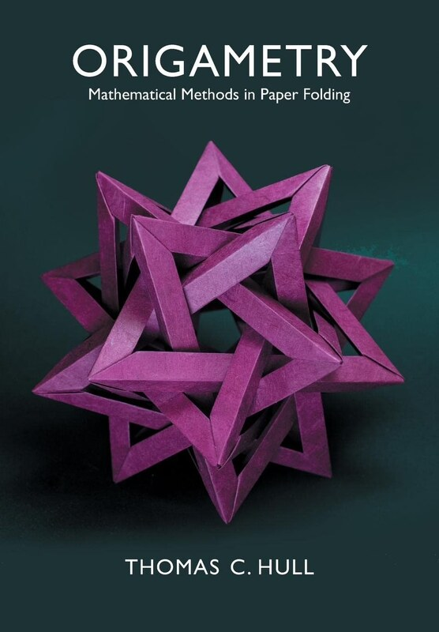

<!-- Editor notes for Jorge in 
<!-- NOTE: double brackets -->; remove before publishing. -->

{fig-alt="Book cover of Origametry showing a folded model of five intersecting tetrahedra" fig-align="center" width="40%"}

**What it is.** Cambridge University Press, 2020 (paperback 2021), 342 pages, about 180 figures. Tom Hull has been collecting the mathematics of paper folding since the late 1980s, when finding a paper on the subject meant leafing through printed volumes of *Mathematical Reviews*, and this is the book he wanted to exist then: one place where the scattered results are gathered, proved in a consistent notation, and tied to their history. It has four parts.

- **Part I, Geometric constructions** (chapters 1–4): what you can construct by folding. Dividing a segment into *n*, trisecting an angle, the heptagon; the basic folding operations (the so-called Huzita–Justin axioms); Beloch's fold and cubic equations; the field of origami numbers; multifolds, Lang's angle quintisection, and constructions with curved creases.
- **Part II, Flat origami** (5–8): Maekawa, Kawasaki, the necessary and sufficient conditions for a vertex to fold flat, counting mountain–valley assignments, global flat-foldability and its NP-hardness, phantom folds of the Miura-ori, the stamp-folding problem, folding paper in half, the fold-and-cut theorem.
- **Part III, Algebra, topology and analysis** (9–11): origami homomorphisms and symmetry groups of tessellations, Robertson's isometric foldings of manifolds, and an analytic approach via Lipschitz maps.
- **Part IV, Rigid origami** (12–14): the matrix model, the Gauss map, infinitesimal rigid foldability, conditions for rigid vertices, the complexity of rigid foldability with optional creases, configuration spaces, and self-foldability.

Every chapter ends with open problems, and most with historical remarks that sort out who proved what and when. There are no exercises: Hull calls the book a monograph, not a textbook, and instead sprinkles 123 "Diversions" through the text. Some are small problems for the reader; others are steps of proofs left for you to fill in, with a reference if you get stuck.

**Who it is for.** Readers who are comfortable with proofs and have met some abstract algebra, point-set topology and a little differential geometry. It is not a folding book: there are almost no models to fold, and the few diagrams of folds are there to state a theorem, not to teach a sequence. If you are a folder who wants to know *why* a crease pattern folds flat, start with Hull's own *Project Origami* or O'Rourke's *How to Fold It*, then come here. If you are a mathematician, engineer or graduate student who needs the actual theorems, this is the book, and the only one.

**What is good.** Three things, from the inside.

First, Part I is the territory I have worked in, and it is handled with care: Beloch's 1936 fold gets its due, the field of origami numbers is built properly, and Lang's quintisection and the multifold operations are explained rather than waved at. I have one quarrel, and it is about credit. Hull introduces the list of basic folding operations in §1.5 as Huzita and Scimemi's (1989), and mentions in passing that Jacques Justin's list "may predate" it. It does, and Hull knows it: his own historical remarks in §1.6 say that the first list in print was Justin's, in *L'Ouvert* in March 1986, and that Justin had all of the operations while Scimemi had only seven. Justin's paper is better than that summary suggests. His table lists exactly seven *folds*, each with its constraint and its number of solutions, and treats the intersection of two lines as a rule of construction rather than an operation, which is why Hull's O2 does not belong in the list in the first place. He then shows that two of the folds suffice, constructs the tower of fields that folding generates, and identifies the last one with closure under real cube roots. That is the content of §1.5 and much of §3.2, written three years before Huzita and Scimemi and announced in 1984. The list should carry Justin's name, and a book this careful about priority everywhere else should have said so in the main text, not in a remark.

Second, Part IV. Rigid origami has an enormous engineering literature and almost no exposition. Chapters 12–14 are the only place where the matrix model, the Gauss-map picture, infinitesimal rigidity and self-foldability are developed from first principles in one notation. For anyone who works on deployable structures or folding mechanisms, these ninety pages are worth the price of the book. 
<!-- NOTE: If you've used them for the *Rigid Origami* book-in-progress on this site, say so; that is a stronger recommendation than any adjective. -->

Third, the open problems. Hull lists them at the end of every chapter and admits they will date the book. They already have, slightly, which is the point: several have been attacked since 2020, and a student looking for a thesis topic could do worse than start here. One of the problems in chapter 10 asks for origami constructions in three dimensions, where creases are planes, and cites Roger Alperin's and my own first steps on that question; I was glad to find it there, and gladder that it is still open.

**What is missing.** Thick origami, which matters in engineering, appears only in the chapter on folding paper in half. Curved creases get a section in Part I and a few diversions, not a chapter; the subject deserves one, but its theory is younger than this book. Design, in the sense of Lang's tree method and circle packing, is summarised in one section and left to *Origami Design Secrets*. And since the Diversions carry parts of proofs, a reader who skips them will sometimes find the argument has a gap; there are no solutions, and the references do not always fill them.

**Verdict.** Five stars as a reference, which is what it sets out to be. It is the book I reach for first when I need the statement of a theorem and the paper that proved it, and the only book I know that treats rigid origami seriously. Just do not make it your first book on the subject.

**Where to buy.** Paperback: [Amazon](https://www.amazon.com/dp/110874611X), US$47 · [Cambridge University Press](https://www.cambridge.org/9781108746113), £37. Prices as of November 2026.
